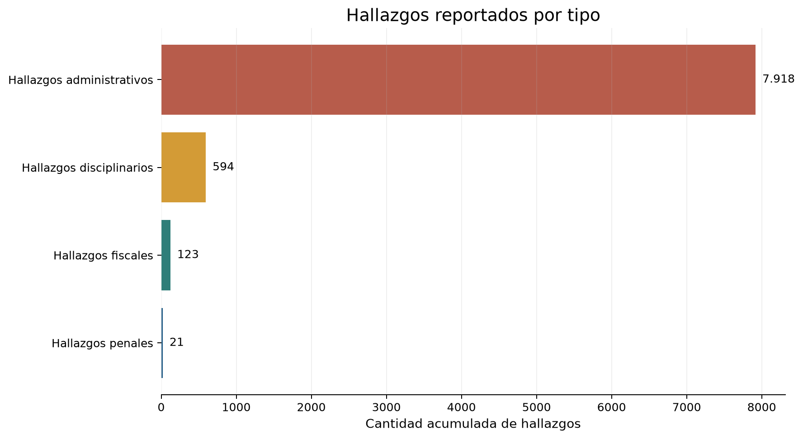
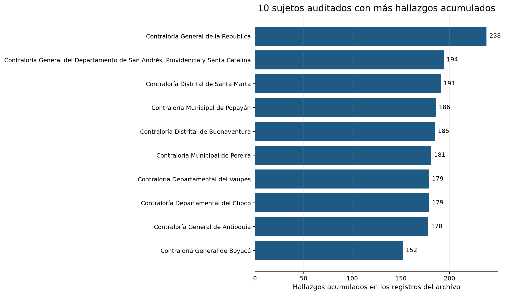
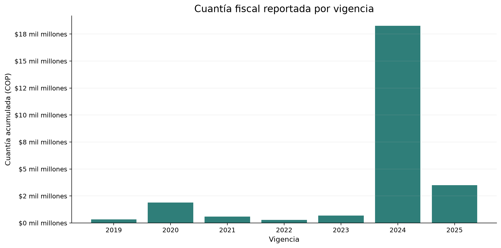
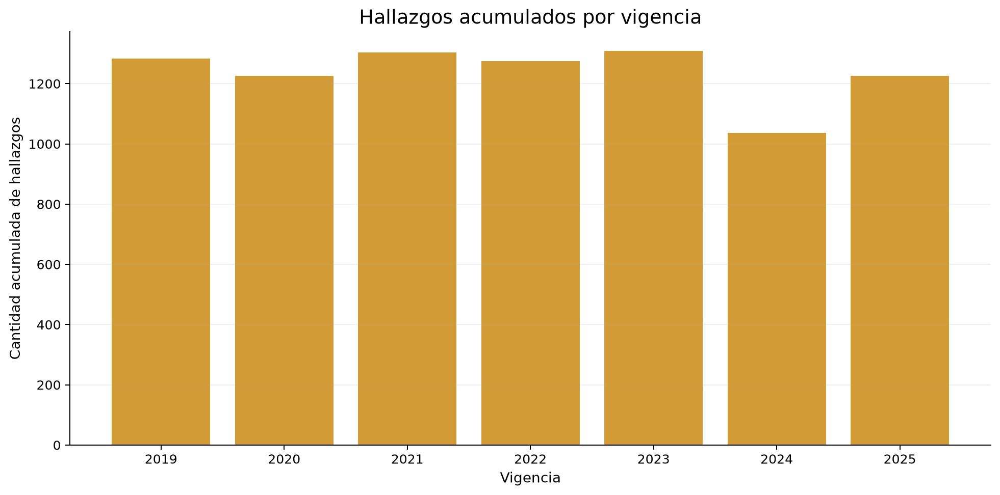
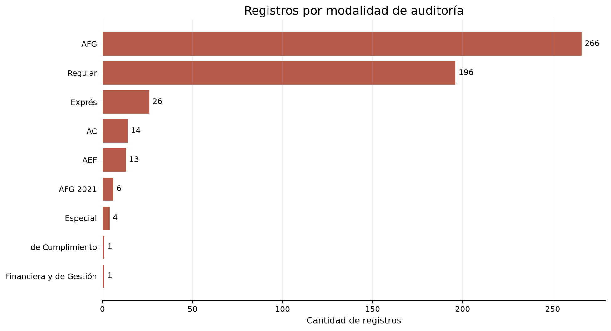

# Conclusiones del dataset Contraloría

## Resumen ejecutivo

El dataset contiene **527 registros** correspondientes a **123 sujetos auditados**. En total se reportan **8.656 hallazgos** y **507 registros (96,2 %)** tienen al menos un hallazgo.

La composición de los hallazgos es la siguiente:

- Hallazgos administrativos: **7.918**.
- Hallazgos disciplinarios: **594**.
- Hallazgos fiscales: **123**.
- Hallazgos penales: **21**.

Los hallazgos administrativos representan aproximadamente el **91,5 %** del total. Por eso, el resultado describe principalmente situaciones administrativas identificadas durante las auditorías. No constituye por sí solo una declaración de responsabilidad jurídica.

## Entidades auditadas

La entidad con mayor número acumulado de hallazgos es la **Contraloría General de la República**, con **238 hallazgos** en 11 registros. Le siguen la Contraloría General del Departamento de San Andrés, Providencia y Santa Catalina, con 194, y la Contraloría Distrital de Santa Marta, con 191.

La entidad con mayor cuantía acumulada es la **Contraloría Municipal de Pereira**, con **$14.985.295.192**. Este valor concentra aproximadamente el **58,6 %** de la cuantía total, por lo que merece una revisión financiera prioritaria.

## Evolución por vigencia

La vigencia con más hallazgos es **2023**, con **1.308**. Le siguen 2021, con 1.304, y 2019, con 1.284.

La vigencia **2024** concentra la mayor cuantía fiscal, con **$18.263.532.535**, equivalente aproximadamente al **71,5 %** del total. Esto muestra que el mayor impacto monetario no coincide necesariamente con la vigencia que tiene más hallazgos.

## Modalidades de auditoría

La modalidad más frecuente es **AFG**, con **266 registros** y **4.641 hallazgos**. También concentra la mayor cuantía acumulada, con **$21.193.935.877**, aproximadamente el **83,0 %** del total.

La modalidad Regular tiene 196 registros y 3.518 hallazgos. Aunque es la segunda modalidad por cantidad de registros, su cuantía acumulada es muy inferior a la de AFG.

## Cuantías y calidad de los datos

La cuantía fiscal acumulada es de **$25.548.545.921**, distribuida en **89 registros** con valor diferente de cero. Los otros **438 registros** no reportan cuantía fiscal.

Esto significa que la cuantía está altamente concentrada en pocos registros. Conviene analizar por separado los casos con valores monetarios altos para evitar que el total general oculte diferencias importantes entre auditorías.

## Recomendaciones

1. Priorizar la revisión de la Contraloría Municipal de Pereira por su concentración de cuantía y de la Contraloría General de la República por su volumen de hallazgos.
2. Analizar de forma independiente los hallazgos fiscales, penales y disciplinarios, porque son menos frecuentes, pero pueden requerir revisión especializada.
3. Comparar las vigencias y modalidades considerando tanto el número de hallazgos como la cuantía, ya que ambas medidas producen prioridades diferentes.
4. Revisar los informes de auditoría originales antes de tomar decisiones administrativas o jurídicas.

Estas conclusiones son descriptivas del archivo entregado y no establecen por sí solas responsabilidad jurídica.

## Gráficas exploratorias

Las siguientes gráficas complementan los conteos y las cuantías descritos arriba. Los valores están agregados por los campos del archivo y no equivalen necesariamente a auditorías independientes.

### Composición de hallazgos

### Sujetos auditados con más hallazgos

### Cuantía fiscal por vigencia

### Hallazgos por vigencia

### Registros por modalidad de auditoría

